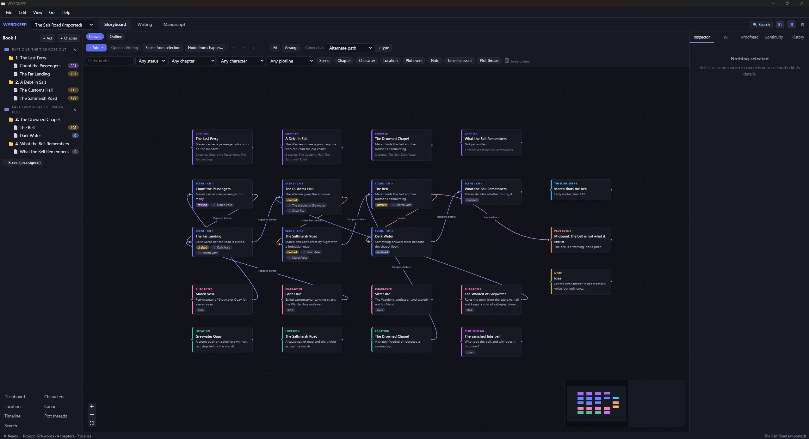
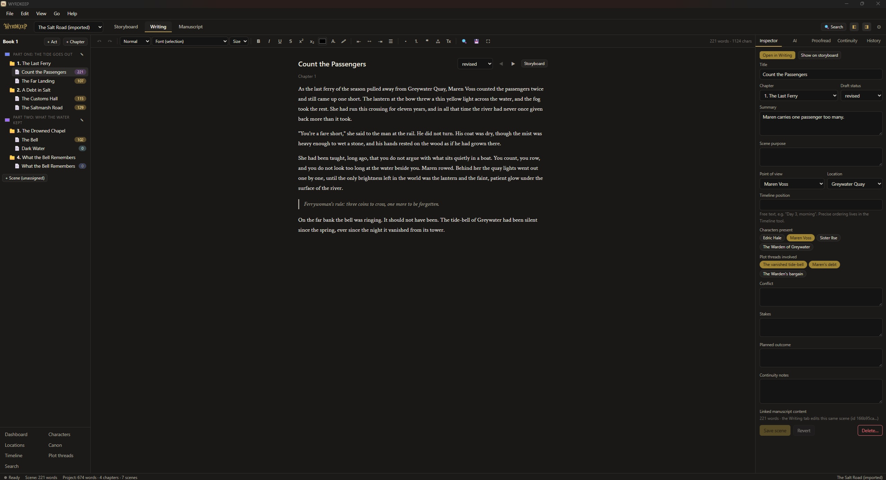
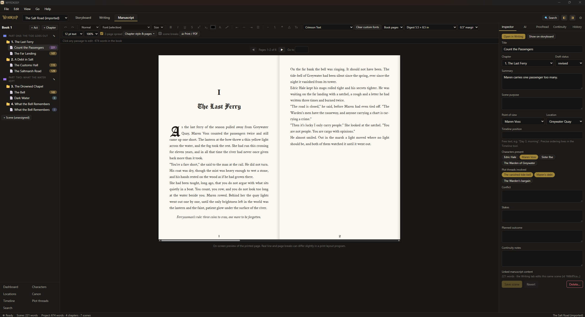
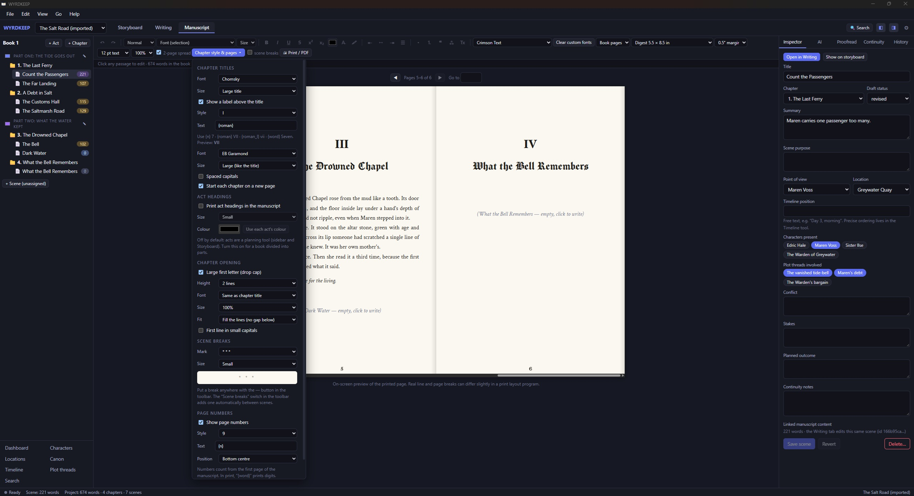
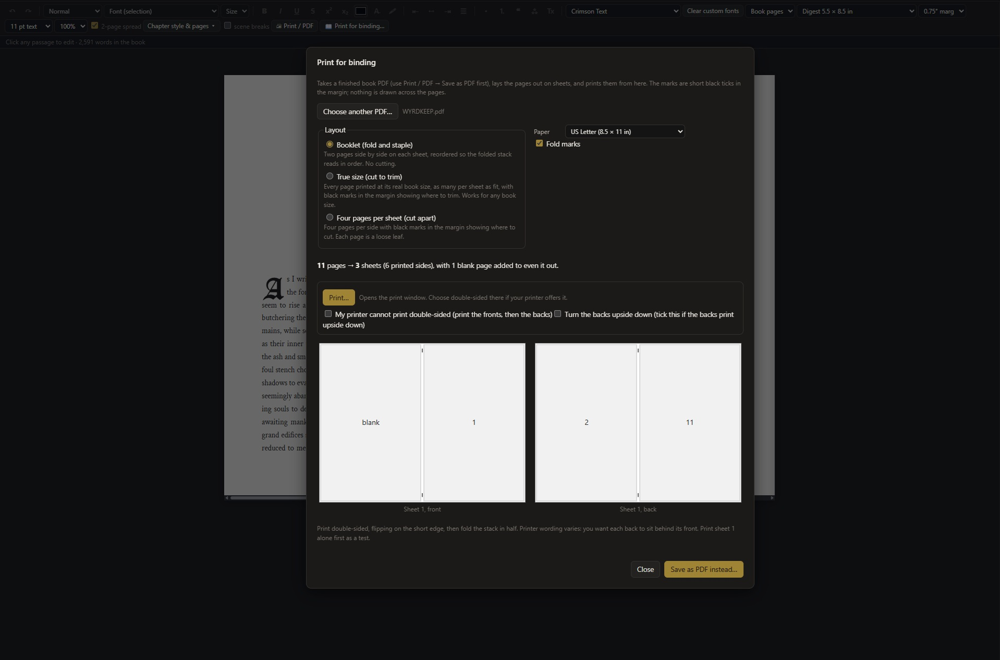

# 

**A desktop novel-writing studio.** Plan your story on a visual storyboard, write it in a full editor, and see it laid out like the pages of a real book. Everything is stored on your own computer.

## Download

Go to the **[Releases](../../releases/latest)** page and download the file for your computer:

| Your computer | Download |
|---|---|
| Windows 10 / 11 | the **setup `.exe`** |
| Mac | the **`.dmg`** |

## Install

### Windows
1. Download the setup `.exe` and double-click it.
2. If you see **"Windows protected your PC"**, click **More info**, then **Run anyway**. This appears because the app is not code-signed yet.
3. Follow the installer. WYRDKEEP then appears in your Start menu.

### Mac
1. Download the `.dmg`, open it and drag **WYRDKEEP** into **Applications**.
2. The first time, macOS may say it is from an unidentified developer, because the app is not signed or notarised. **Right-click (or Control-click) the app, choose Open, then Open again.**
3. The Mac version is new and has had less testing than the Windows one. If something does not work, please tell me.

### Linux

1. Download one of the three files from the latest release:

- AppImage (`.AppImage`): works on most 64-bit Intel/AMD Linux desktops without installing anything. Make it executable (`chmod +x WYRDKEEP*.AppImage`) and run it, or right-click it, open Properties and tick "Allow executing as a program".
- Debian / Ubuntu / Mint (`.deb`): `sudo apt install ./WYRDKEEP*.deb`
- Fedora / openSUSE (`.rpm`): `sudo dnf install ./WYRDKEEP*.rpm`

The Linux builds are made on Ubuntu 22.04, so Ubuntu 22.04 or newer (or an equivalent distribution) is the safest choice. The Linux versions have limited testing. If something does not work, please tell me.

If the AppImage won't start:
- On newer Ubuntu, install FUSE first: `sudo apt install libfuse2`. Or run it with `./WYRDKEEP*.AppImage --appimage-extract-and-run`.
- If the window opens blank, try: `WEBKIT_DISABLE_DMABUF_RENDERER=1 ./WYRDKEEP*.AppImage`

Your projects are stored on your computer, in your user data folder. Please report problems on the Issues page.

## What it does

- **Storyboard.** A canvas of cards for scenes, chapters, characters, locations, plot events, notes, timeline events and plot threads. Connect them with arrows such as "Happens before" or "Foreshadows", and filter or rearrange them.
- **Writing.** A manuscript tree (book, acts, chapters, scenes), a rich-text editor, find and replace, focus mode, autosave and revision history.
- **Manuscript.** Your whole book as pages, with trim sizes, margins, two-page spreads, chapter headings in the fonts you choose, drop caps, scene-break marks (including your own picture), page numbers and print or PDF.
- **Fonts.** Built-in book and blackletter fonts, and you can add your own font files.
- **Reference.** Characters, locations, canon facts, plot threads and a timeline.
- **Proofreading and continuity checks.** Built-in checks, optional LanguageTool, and checks for things like a character appearing after they died.
- **Export.** Word (`.docx`), EPUB, Markdown and plain text.
- **Optional AI help.** Brainstorming, continuing a scene, rewriting and more, using a model on your own computer (such as Ollama or LM Studio) or an online service. Nothing changes your manuscript until you accept it.
- 

## Your writing stays with you

- Your projects are saved on your own computer. The app makes no network requests by itself.
- AI is **off for online services by default**. Nothing is sent anywhere unless you add an online AI provider **and** switch on *Settings → Privacy → Allow project content to be sent to online AI services*.
- API keys for online AI are kept in the system's credential store (Windows Credential Manager or macOS Keychain), never in your project files.
- The app makes automatic backups while you work. You can also make one from **Settings → Library backups**.
  

## Getting started

1. Open WYRDKEEP and click **New project**.
2. Use the **Storyboard** tab to plan, or go straight to **Writing** and add a chapter and a scene.
3. Open the **Manuscript** tab to see the book as pages. The **Chapter style & pages** menu controls chapter headings, drop caps, scene breaks and page numbers.
4. Export from **File → Export manuscript** when you want a Word, EPUB or text copy.
5. Optional: add an AI provider in **Settings → AI providers**.

## Print for binding

Turn your finished book into pages you can print at home and bind.

### How to use it

1. Save your book as a PDF: in the **Manuscript** tab, click **Print / PDF** and choose **Save as PDF**.
2. Click **Print for binding...** (next to Print / PDF) and choose that PDF.
3. Pick a layout and a paper size. A picture of the first sheet shows what you will get.
4. Click **Print**, or **Save as PDF instead...** to print the file from another program.

### Layouts

| Layout | What you get |
|---|---|
| **Booklet** | Two pages per sheet, in the right order for folding and stapling. Pages keep their real size. |
| **True size** | Every page at its real book size, as many per sheet as fit, then trim. |
| **Four per sheet** | Four loose pages per side to cut apart. |

Paper sizes: Letter, Legal, Tabloid, A5, A4 and A3. Short black marks in the margins show where to fold or cut, and nothing is drawn across your pages.

### Tips

- **Double-sided:** for a booklet, set double-sided printing to *flip on the short edge*. Print sheet 1 alone first to check that the back lines up.
- **No double-sided printer?** Tick the box for that. The app prints the fronts first, then you put the sheets back in the tray and it prints the backs.
- **Backs upside down?** Tick *Turn the backs upside down*.
- **Mac and Linux:** use **Save as PDF instead...** and print the saved file from a PDF viewer. Printing from the app window is only tested on Windows.
- 

## Known limits

- The page view is a close preview on screen, not an exact print layout. Line and page breaks can differ slightly in other programs.
- Chapter styling, drop caps and fonts are not carried into the Word and EPUB exports, and fonts are not embedded in them.
- The one-click LanguageTool download installs Java automatically on Windows only. On a Mac, install Java 17 or newer first.
- The app is not code-signed, so Windows and macOS show a warning the first time you run it.

## Questions or problems

Open an **Issue** on this page and describe what happened, or contact the author directly.
